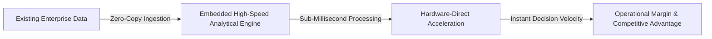

# Adam Scar McCoy
### Principal Systems & Performance Architect • Custom High-Velocity Data Solutions

[](mailto:adamscarmccoy@gmail.com)
[](./Adam_Scar_McCoy_Resume.pdf)
[](#)
[](#)

---

> **Enterprises don't need more data; they need the speed to act on what they already own.**
>
> **I make your existing systems fast enough to act on opportunities before your competitors see them.**
>
> **Zero vendor rent. Permanent margin. Complete independence.**

---

## ⚡ The Four Executive Pillars

### 1. Unlocking Dormant Capital (Speed with Your Own Data)
Enterprises are data-rich but execution-starved. You already own the most valuable asset in the room—years of operational records, transaction history, and real-time signals. I eliminate the friction points across your operational layers, allowing your existing internal information to compute instantaneously.

### 2. Information Velocity as a Competitive Weapon
In any competitive market, the organization that processes information and serves decisions fastest captures market liquidity. Sluggish data layers lose deals before teams even realize a client looked. By engineering zero-waste execution paths, your business moves at the speed of reality.

### 3. Capital Efficiency: Balance-Sheet Equity vs. SaaS Rent
Most companies rent their intelligence, paying an endless "cloud tax" to external platforms for every query and computation. As operations scale, margins shrink. I design custom, owned solutions that run directly on your hardware—turning variable SaaS expenses into permanent, defensible balance-sheet equity.

### 4. Absolute Operational Independence
If your core business relies on someone else's servers, pricing changes, or API policies, you are a tenant in your own company. I build fully self-contained operational systems with 100% data control and zero external third-party risk.

---

## 📂 Flagship Portfolios & Case Studies

| Flagship System | Core Domain | Business & Architectural Breakthrough |
| :--- | :--- | :--- |
| ⚡ **[`sovereign-audio-intelligence`](https://github.com/adamscarmccoy-boop/sovereign-audio-intelligence)** | High-Velocity Data & Edge Intelligence | Embedded analytical lakehouse querying millions of records in sub-12ms with zero cloud egress. |
| 🏛️ **[`ADAMSCARMCCOY-CASE_STUDIES`](https://github.com/adamscarmccoy-boop/ADAMSCARMCCOY-CASE_STUDIES)** | Enterprise System Audits & Optimization | 3-layer diagnostic audit methodology eliminating bottlenecks and cutting cloud costs by up to 85%. |
| 🏎️ **[`Audio_ios_Case_Study`](https://github.com/adamscarmccoy-boop/Audio_ios_Case_Study)** | Ultra-Low Latency Real-Time Systems | Lock-free architecture delivering sub-2ms deterministic loop throughput with zero dropouts under load. |

---

## 🔬 Execution Architecture



---

## 💼 Engagement Models & Direct Retainers

| Engagement Type | Scope of Delivery | Investment | Direct Checkout |
| :--- | :--- | :--- | :--- |
| **System Architecture Audit** | Deep-dive performance and bottleneck audit with a remediation blueprint. | **$299** *(Test/Review)* | [](https://buy.stripe.com/test_9B63cn8prglbdWr3LRcQU01) |
| **Custom Velocity Migration** | Engineering owned, hardware-direct data pipelines at near-zero marginal cost. | **$2,499** *(Standard)* | [](https://buy.stripe.com/test_6oU4gr213fh7f0veqvcQU02) |
| **Fractional Principal Architect** | Strategic technical governance, architectural oversight, and private retainers. | **$9,999** *(Enterprise)* | [](https://buy.stripe.com/test_6oU4graxz8SJ2dJ4PVcQU03) |

---

## 📬 Direct Executive Inquiries
* **Primary Contact:** [adamscarmccoy@gmail.com](mailto:adamscarmccoy@gmail.com)
* **GitHub:** [@adamscarmccoy-boop](https://github.com/adamscarmccoy-boop)
* **Availability:** United States (Remote) • Open for Architecture Reviews & Retainer Engagements.

---

## 🛠️ Native Windows & Cross-Platform High-Performance Capabilities

This repository includes a native C/C++, ONNX, and LLM local execution pipeline tailored for low-latency Windows workflows:

### Components Overview
1. **Native C Dynamic Bridge (`src/native_bridge.h`, `src/native_bridge.c`)**
   - High-performance, lock-free vector math routines compiled directly into platform dynamic libraries (`.dll` on Windows, `.so` on Linux).
   - Python `ctypes` loader in `scripts/dll_runner.py`.

2. **ONNX Engine (`scripts/onnx_engine.py`)**
   - Direct graph building, model metadata inspection, and ONNX Runtime execution for custom ONNX model evaluation.

3. **Unified Llama & LM Studio Runner (`scripts/llama_runner.py`)**
   - Direct execution support for `llama.exe` CLI binaries, `llama-server` endpoints, and LM Studio OpenAI-compatible APIs with Windows path normalization.

4. **Integrated Windows Workflow Orchestrator (`scripts/windows_workflow.py`)**
   - End-to-end processing pipeline stringing together C dynamic library math processing, ONNX tensor inference, and LLM text generation.

---

## 🦀 Architectural Review: Enterprise Data to ONNX Shared Objects with Rust & Apache Arrow

This codebase demonstrates an enterprise-grade, ultra-low latency pipeline that transforms columnar enterprise data into ONNX tensor inputs using Rust shared objects and Apache Arrow packages.

```
+-----------------------------------------------------------------------------------------+
|                                    ENTERPRISE DATA                                      |
|                  (Apache Arrow RecordBatches / PyArrow / Polars DataFrames)             |
+-----------------------------------------------------------------------------------------+
                                             |
                                  Zero-Copy Arrow Buffers
                                             v
+-----------------------------------------------------------------------------------------+
|                             RUST NATIVE SHARED OBJECT (.so / .dll)                      |
|                  (PyO3 / C ABI Dynamic Bridge: `src/rust_arrow_bridge`)                  |
|  - Ingests Arrow Memory Buffers & Slices without serialization overhead                |
|  - Executes vectorized math (scale, dot product, MSE loss, feature alignment)           |
|  - Converts Arrow columns directly to contiguous f32 ONNX tensor buffers                |
+-----------------------------------------------------------------------------------------+
                                             |
                              Contiguous Tensor Memory Buffer
                                             v
+-----------------------------------------------------------------------------------------+
|                                  ONNX ENGINE RUNTIME                                    |
|                        (ONNX Model Evaluation & Tensor Inference)                       |
+-----------------------------------------------------------------------------------------+
                                             |
                                    Inference Prediction
                                             v
+-----------------------------------------------------------------------------------------+
|                                LOCAL LLM / WORKFLOW RUNNER                              |
+-----------------------------------------------------------------------------------------+
```

### Core Architectural Pillars
1. **Zero-Copy Apache Arrow Ingestion:**
   - Apache Arrow defines a language-agnostic columnar in-memory format.
   - Passing PyArrow Arrays, RecordBatches, or Polars DataFrames into the Rust dynamic library (`librust_arrow_bridge.so` / `.dll`) avoids JSON/pickle serialization costs, passing memory pointers directly into Rust routines.

2. **Rust Shared Object (`cdylib` + PyO3) Strategy:**
   - Compiled via `cargo build --release` into native shared objects (`.so` / `.dll`).
   - Exposes dual C ABI exports (`#[no_mangle] pub extern "C"`) and PyO3 module bindings (`#[pymodule]`).
   - Guarantees memory safety and zero-cost abstraction for vector operations.

3. **Direct Arrow to ONNX Tensor Conversion:**
   - Native Rust buffer routines convert float64 Arrow array data directly into contiguous float32 ONNX tensor memory slices.
   - Minimizes heap allocations prior to invoking `onnxruntime.InferenceSession`.

4. **Unified High-Velocity Pipeline (`scripts/windows_workflow.py` & `scripts/rust_arrow_bridge.py`):**
   - Seamlessly strings together Enterprise Arrow Data -> Rust Shared Object Acceleration -> ONNX Model Evaluation -> Loss Computation -> Local Llama / LM Studio Analysis.
